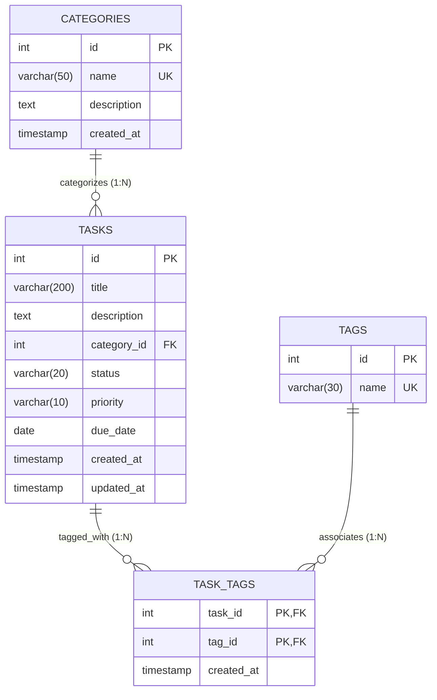
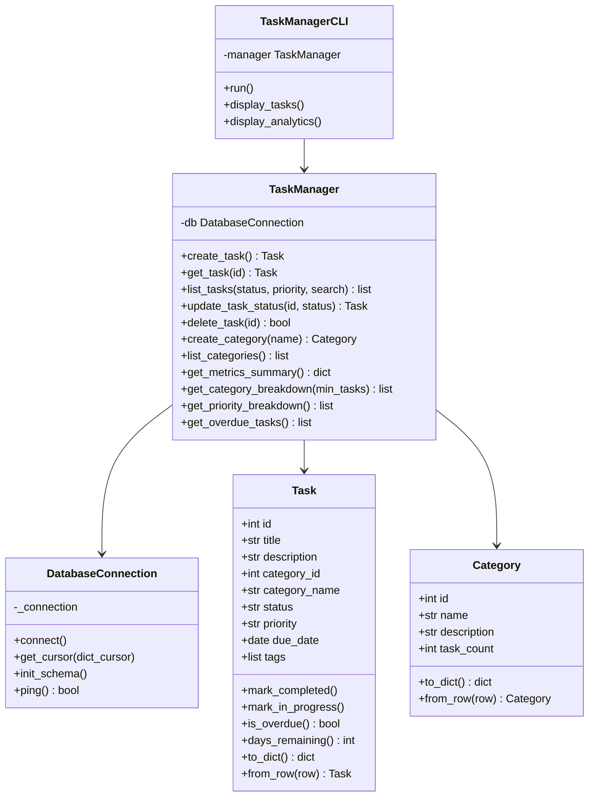
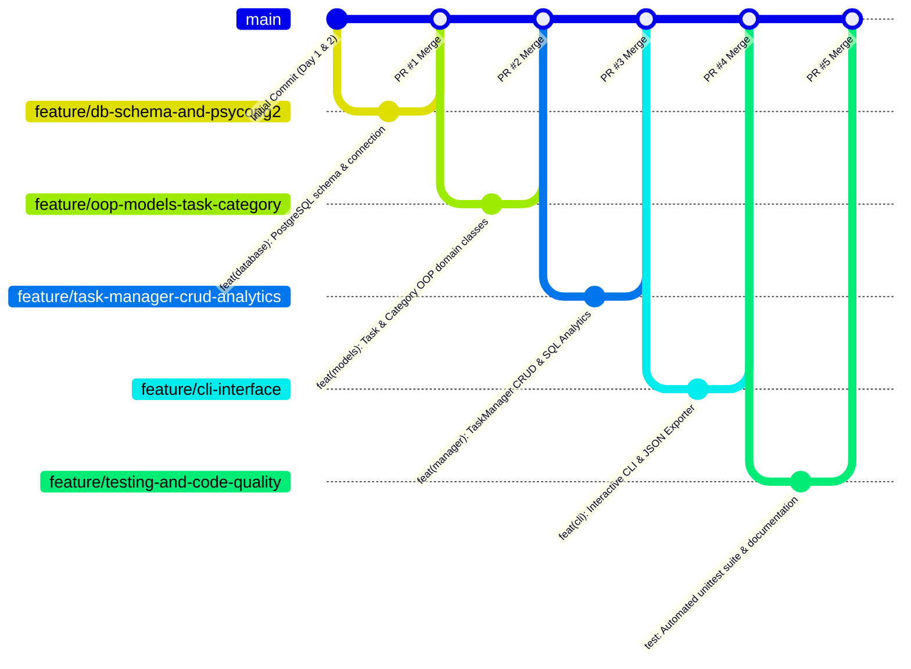

# 🚀 Day 4 — SQL & Git Foundations + Mini-Project 1: CLI Task Manager

A production-ready, object-oriented Command-Line Interface (CLI) Task Manager backed by a live PostgreSQL database via `psycopg2`. Built with clean architecture, relational database normalization, advanced SQL queries (`JOINs`, `GROUP BY`, `HAVING`, aggregates), structured JSON export, comprehensive logging, and an automated `unittest` test suite.

---

## 📑 Table of Contents
1. [Architectural Overview](#-architectural-overview)
2. [Database Design & Relational Model](#-database-design--relational-model)
3. [SQL Foundations Demonstrated](#-sql-foundations-demonstrated)
4. [Software Design & OOP Architecture](#-software-design--oop-architecture)
5. [Git Workflow & GitHub Flow](#-git-workflow--github-flow)
6. [Testing & Quality Assurance](#-testing--quality-assurance)
7. [Installation & Quickstart Guide](#-installation--quickstart-guide)
8. [CLI Usage & Examples](#-cli-usage--examples)

---

## 🏛 Architectural Overview

```
04_sql_and_git_task_manager/
├── .env.example              # Environment variables template
├── .gitignore                # Module-level git exclusions
├── requirements.txt          # Python package dependencies
├── config.py                 # Centralized configuration & environment loader
├── start_pg.ps1              # Helper script to launch local PostgreSQL daemon
├── stop_pg.ps1               # Helper script to stop local PostgreSQL daemon
├── main.py                   # CLI entrypoint & argument parser
├── cli.py                    # Interactive terminal user interface & ASCII tables
│
├── database/                 # Database Layer
│   ├── __init__.py
│   ├── connection.py         # DatabaseConnection manager & connection pooling
│   ├── schema.sql            # DDL: Tables, constraints, foreign keys, indexes
│   ├── queries.sql           # Reference SQL queries (JOINs, HAVING, aggregates)
│   └── seed.py               # Database seeder with realistic test data
│
├── models/                   # Domain Model Layer (OOP)
│   ├── __init__.py
│   ├── exceptions.py         # Custom domain exception hierarchy
│   ├── category.py           # Category entity with validation & serialization
│   └── task.py               # Task entity with state transitions & validation
│
├── managers/                 # Business Logic Layer
│   ├── __init__.py
│   └── task_manager.py       # TaskManager orchestrating CRUD & analytics
│
├── utils/                    # Utility Services
│   ├── __init__.py
│   ├── logger.py             # Rotating file + stream logging service
│   └── exporter.py           # Structured JSON exporter with metadata
│
├── exports/                  # Export Directory
│   └── tasks_export.json     # Generated structured JSON exports
│
└── tests/                    # Automated Test Suite
    ├── __init__.py
    ├── test_models.py        # Unit tests for domain models & validation
    ├── test_manager.py       # Integration tests for TaskManager CRUD & constraints
    ├── test_queries_and_joins.py # Direct tests for JOINs, GROUP BY, and HAVING
    └── test_exporter.py      # Unit tests for JSON serialization
```

---

## 🗄 Database Design & Relational Model

The system utilizes PostgreSQL 17 to implement a normalized 3NF relational schema with 1-to-Many and Many-to-Many relationships:



### Key Relational Features
1. **Primary & Foreign Keys**:
   - `categories.id` (`SERIAL PRIMARY KEY`)
   - `tasks.id` (`SERIAL PRIMARY KEY`)
   - `tasks.category_id` references `categories(id)` with `ON DELETE SET NULL`
   - `task_tags` composite primary key `(task_id, tag_id)` with `ON DELETE CASCADE`
2. **Integrity & Check Constraints**:
   - `CHECK (status IN ('pending', 'in_progress', 'completed', 'archived'))`
   - `CHECK (priority IN ('low', 'medium', 'high', 'urgent'))`
   - `UNIQUE (name)` on categories and tags
3. **B-Tree Indexes**:
   - `idx_tasks_category_id`: Accelerates relational joins
   - `idx_tasks_status`: Optimizes status filtering
   - `idx_tasks_priority`: Accelerates priority sorting and filtering
   - `idx_tasks_due_date`: Enables high-speed overdue task scans
   - `idx_task_tags_tag_id`: Speeds reverse tag searches

---

## 📊 SQL Foundations Demonstrated

The project contains hands-on implementations of essential SQL relational concepts:

### 1. Relational JOINs
- **INNER JOIN**: Filters tasks that strictly possess an assigned category.
- **LEFT JOIN**: Preserves tasks without categories (displaying `"Uncategorized"`) and preserves categories that currently have zero tasks assigned (`Empty Category`).
- **Many-to-Many JOIN with Aggregation**:
  ```sql
  SELECT 
      t.id, t.title, c.name AS category_name,
      COALESCE(STRING_AGG(tg.name, ', ' ORDER BY tg.name), 'No Tags') AS tags
  FROM tasks t
  LEFT JOIN categories c ON t.category_id = c.id
  LEFT JOIN task_tags tt ON t.id = tt.task_id
  LEFT JOIN tags tg ON tt.tag_id = tg.id
  GROUP BY t.id, t.title, c.name;
  ```

### 2. GROUP BY, HAVING & Aggregate Functions
- **Aggregate Metrics**: `COUNT(*)`, `COUNT(CASE WHEN status = 'completed' THEN 1 END)`, `MIN(due_date)`, `MAX(due_date)`.
- **GROUP BY with HAVING**:
  Filters aggregated groups *after* grouping has taken place (unlike `WHERE` which filters rows before aggregation):
  ```sql
  SELECT 
      c.name AS category_name,
      COUNT(t.id) AS total_tasks,
      COUNT(CASE WHEN t.status = 'completed' THEN 1 END) AS completed_tasks
  FROM categories c
  LEFT JOIN tasks t ON c.id = t.category_id
  GROUP BY c.id, c.name
  HAVING COUNT(t.id) >= 2
  ORDER BY total_tasks DESC;
  ```

### 3. Date Arithmetics & Overdue Detection
```sql
SELECT 
    t.id, t.title, t.due_date,
    (CURRENT_DATE - t.due_date) AS days_overdue
FROM tasks t
WHERE t.status != 'completed' AND t.due_date < CURRENT_DATE
ORDER BY t.due_date ASC;
```

---

## 💻 Software Design & OOP Architecture



### Custom Exception Hierarchy
- `TaskManagerError` (Root base exception)
  - `ValidationError` (Raised on invalid date formats, empty titles, illegal statuses)
  - `TaskNotFoundError` (Raised when task ID does not exist)
  - `CategoryNotFoundError` (Raised when category ID does not exist)
  - `DatabaseError` (Wraps psycopg2 operational and integrity errors safely)

---

## 🔀 Git Workflow & GitHub Flow

This project follows **GitHub Flow** with systematic, descriptive commits and clean feature branching:



### Pushing to GitHub
To push this repository to GitHub under your account:
```powershell
# 1. Create a remote repository on GitHub named 'Narasimha' or 'python-intensive'
# 2. Add the remote origin
git remote add origin https://github.com/Venkata-Narasimha-11/Narasimha.git

# 3. Push your main branch and all tags
git branch -M main
git push -u origin main
```

---

## 🧪 Testing & Quality Assurance

The codebase includes an automated test suite with 25 unit and integration tests across 4 test modules:

```powershell
# Run the complete test suite with unittest discover
python -m unittest discover -s 04_sql_and_git_task_manager/tests -p "test_*.py" -v

# Run with pytest (if installed)
python -m pytest 04_sql_and_git_task_manager/tests -v
```

### Test Coverage Highlights
- ✅ Model validations (empty title, invalid priority/status, date formatting)
- ✅ State transitions (`mark_completed`, `mark_in_progress`, overdue calculations)
- ✅ Full CRUD operations for tasks and categories
- ✅ Foreign Key cascades and `ON DELETE SET NULL` assertions
- ✅ SQL JOIN verifications (LEFT JOIN preserving empty categories)
- ✅ `GROUP BY` and `HAVING` group filtering validation
- ✅ Structured JSON export verification and file persistence

---

## ⚡ Installation & Quickstart Guide

### 1. Requirements
- Python 3.10+
- PostgreSQL 17 (installed locally or via service)
- `psycopg2-binary`

### 2. Start PostgreSQL Instance
Use the provided PowerShell helper to boot up the local database cluster on port `5433`:
```powershell
.\04_sql_and_git_task_manager\start_pg.ps1
```

### 3. Seed Sample Data
```powershell
python 04_sql_and_git_task_manager/database/seed.py
```

### 4. Stop Database Daemon
```powershell
.\04_sql_and_git_task_manager\stop_pg.ps1
```

---

## 🖥 CLI Usage & Examples

### Interactive CLI Mode
Simply execute `main.py` without arguments:
```powershell
python 04_sql_and_git_task_manager/main.py
```

### Direct CLI Flag Commands
```powershell
# List all tasks in formatted table
python 04_sql_and_git_task_manager/main.py --list

# Filter tasks by status and priority
python 04_sql_and_git_task_manager/main.py --list --status pending --priority urgent

# Quickly add a high-priority task with a due date
python 04_sql_and_git_task_manager/main.py --add "Deploy API to Staging" --priority high --due 2026-10-15 --category 1

# View comprehensive SQL Analytics (Aggregates, Category Breakdown, Priority Stats, Overdue Tasks)
python 04_sql_and_git_task_manager/main.py --analytics

# Export tasks to a structured JSON file
python 04_sql_and_git_task_manager/main.py --export

# Re-seed database with sample data
python 04_sql_and_git_task_manager/main.py --seed
```
