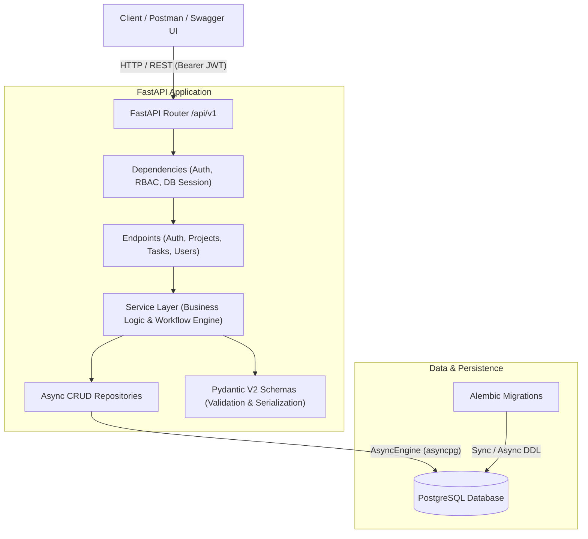
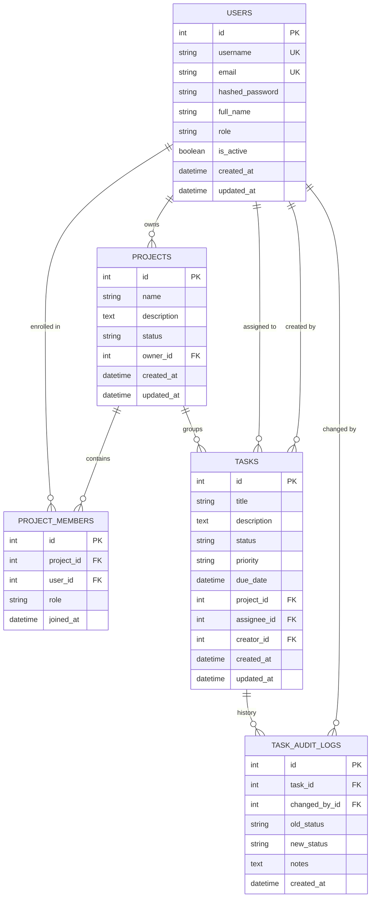
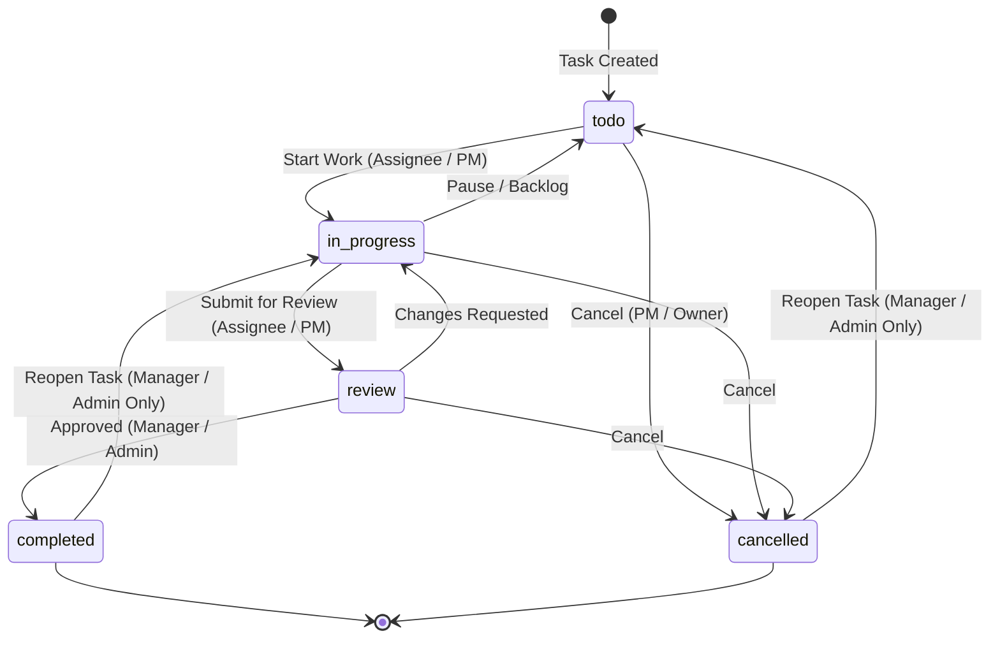

# Enterprise Task Management REST API (Mini-Project 2)

[](https://fastapi.tiangolo.com)
[](https://www.python.org)
[](https://www.sqlalchemy.org)
[](https://www.postgresql.org)
[](https://alembic.sqlalchemy.org)
[](https://jwt.io)
[](https://pytest.org)

A production-grade, asynchronous Task Management REST API built with **FastAPI**, **SQLAlchemy 2.0**, **PostgreSQL**, **Alembic**, and **Pydantic V2**. Features robust JWT authentication, fine-grained Role-Based Access Control (RBAC), a workflow state machine with immutable audit logging, multi-criteria filtering, structured pagination envelopes, uniform error responses, and complete Postman/Swagger documentation.

---

## 📑 Table of Contents

- [Architectural Overview](#-architectural-overview)
- [Database Schema & ERD](#-database-schema--erd)
- [Task Workflow State Machine](#-task-workflow-state-machine)
- [Role-Based Access Control (RBAC)](#-role-based-access-control-rbac)
- [API Reference Matrix](#-api-reference-matrix)
- [Project Directory Structure](#-project-directory-structure)
- [Quickstart & Running Instructions](#-quickstart--running-instructions)
- [Automated Testing & Demos](#-automated-testing--demos)
- [Postman Collection Usage](#-postman-collection-usage)
- [Peer Code Review](#-peer-code-review)

---

## 🏗 Architectural Overview

The application follows the **Layered Clean Architecture** pattern:



---

## 🗄 Database Schema & ERD



---

## 🔄 Task Workflow State Machine

The task status transition lifecycle is governed by an explicit finite state machine enforced by the `WorkflowEngine`:



- **Disallowed Transitions**: Any transition outside the graph (e.g. `todo` directly to `completed`) raises `400 Bad Request` (`INVALID_STATUS_TRANSITION`).
- **Privileged Transitions**: Reopening terminal states (`completed` ➔ `in_progress` or `cancelled` ➔ `todo`) requires `admin` or `manager` privileges.
- **Audit Logging**: Every successful status transition automatically appends an immutable entry to `task_audit_logs`.

---

## 👥 Role-Based Access Control (RBAC)

| Role | Project Permissions | Task Permissions | Workflow Permissions |
| :--- | :--- | :--- | :--- |
| **Admin** | Full access to all projects across system. Delete any project. | Full access across all tasks and projects. | Full override across all transitions and reopens. |
| **Manager** | Create projects, update/delete owned projects, manage team members. | Create, edit, and reassign tasks within accessible projects. | Approve reviews (`review` ➔ `completed`), reopen completed tasks. |
| **Developer** | View owned or enrolled projects. | Create tasks in accessible projects, edit assigned/created tasks. | Move forward: `todo` ➔ `in_progress` ➔ `review`. Cannot reopen closed tasks. |
| **Viewer** | Read-only view of accessible projects. | Read-only view of tasks. | Blocked from all status changes (`403 Forbidden`). |

---

## 📡 API Reference Matrix

### 1. Authentication (`/api/v1/auth`)

| Method | Endpoint | Access | Summary |
| :--- | :--- | :--- | :--- |
| `POST` | `/api/v1/auth/register` | Public | Register a new user account with role selection. |
| `POST` | `/api/v1/auth/login` | Public | JSON login returning JWT access & refresh tokens. |
| `POST` | `/api/v1/auth/token` | Public | OAuth2 Password Grant login (Swagger UI integration). |
| `POST` | `/api/v1/auth/refresh` | Public | Exchange refresh token for renewed access token. |
| `GET` | `/api/v1/auth/me` | Authenticated | Retrieve current user profile and role. |

### 2. Users (`/api/v1/users`)

| Method | Endpoint | Access | Summary |
| :--- | :--- | :--- | :--- |
| `GET` | `/api/v1/users/` | Authenticated | List users (paginated, with role filter). |
| `GET` | `/api/v1/users/{id}` | Authenticated | Fetch single user profile by ID. |
| `PUT` | `/api/v1/users/{id}` | Self / Admin | Update profile or modify role/active status (Admin only). |

### 3. Projects (`/api/v1/projects`)

| Method | Endpoint | Access | Summary |
| :--- | :--- | :--- | :--- |
| `POST` | `/api/v1/projects/` | Non-Viewer | Create project. Creator becomes owner and Lead. |
| `GET` | `/api/v1/projects/` | Authenticated | List accessible projects with pagination and status filter. |
| `GET` | `/api/v1/projects/{id}` | Enrolled / Admin | Get project details, team members, and task status metrics. |
| `PUT` | `/api/v1/projects/{id}` | Owner / Manager | Update project name, description, or status. |
| `DELETE` | `/api/v1/projects/{id}` | Owner / Admin | Delete project and cascade-delete tasks & members. |
| `POST` | `/api/v1/projects/{id}/members` | Owner / Manager | Add team member to project with specified role. |

### 4. Tasks (`/api/v1/tasks`)

| Method | Endpoint | Access | Summary |
| :--- | :--- | :--- | :--- |
| `POST` | `/api/v1/tasks/` | Non-Viewer | Create task in project with priority and due date. |
| `GET` | `/api/v1/tasks/` | Authenticated | List tasks with dynamic filtering, sorting, and pagination. |
| `GET` | `/api/v1/tasks/{id}` | Enrolled / Admin | Get task details, allowed transitions, and audit trail. |
| `PUT` | `/api/v1/tasks/{id}` | Assignee / PM | Full update of task details (title, description, priority). |
| `PATCH` | `/api/v1/tasks/{id}` | Assignee / PM | Partial update of task attributes. |
| `PATCH` | `/api/v1/tasks/{id}/status` | Assignee / PM | Execute workflow status transition with state machine check. |
| `PATCH` | `/api/v1/tasks/{id}/assign` | PM / Owner | Assign or reassign task to team member. |
| `GET` | `/api/v1/tasks/{id}/history` | Enrolled / Admin | Retrieve full chronological audit history trail. |
| `DELETE` | `/api/v1/tasks/{id}` | Creator / Admin | Delete task and its audit history. |

### 5. System Diagnostics (`/api/v1`)

| Method | Endpoint | Access | Summary |
| :--- | :--- | :--- | :--- |
| `GET` | `/api/v1/health` | Public | Health check verifying API status and live database ping. |
| `GET` | `/docs` | Public | Interactive Swagger UI API documentation. |
| `GET` | `/redoc` | Public | ReDoc interactive API specification. |

---

## 📁 Project Directory Structure

```text
07_task_management_api/
├── alembic/                          # Alembic Database Migration Package
│   ├── versions/
│   │   └── 001_initial_task_mgmt.py  # Initial relational schema migration
│   ├── env.py                        # Async Alembic execution environment
│   └── script.py.mako                # Revision template
├── app/
│   ├── api/
│   │   ├── deps.py                   # Auth dependencies & RBAC guards
│   │   └── v1/
│   │       ├── endpoints/
│   │       │   ├── auth.py           # Registration, login, token refresh
│   │       │   ├── users.py          # User management endpoints
│   │       │   ├── projects.py       # Projects CRUD & membership endpoints
│   │       │   └── tasks.py          # Tasks CRUD, workflows, & filters
│   │       └── router.py             # Router aggregator & health check
│   ├── core/
│   │   ├── config.py                 # Pydantic Settings V2 configuration
│   │   ├── security.py               # Bcrypt password hashing & JWT encode/decode
│   │   ├── exceptions.py             # Custom domain exceptions & handlers
│   │   └── workflow.py               # Finite state machine & transition rules
│   ├── db/
│   │   ├── base.py                   # DeclarativeBase & TimestampMixin
│   │   └── session.py                # AsyncEngine & session dependency
│   ├── models/                       # SQLAlchemy 2.0 ORM Declarations
│   │   ├── user.py                   # User model & UserRole enum
│   │   ├── project.py                # Project & ProjectMember models
│   │   ├── task.py                   # Task model, status, & priority enums
│   │   └── audit_log.py              # TaskAuditLog entity
│   ├── schemas/                      # Pydantic V2 Request & Response Contracts
│   │   ├── common.py                 # Pagination envelope & HealthCheck
│   │   ├── auth.py                   # Tokens, login, registration schemas
│   │   ├── user.py                   # User response, update, & summary
│   │   ├── project.py                # Project response, details, & metrics
│   │   ├── task.py                   # Task CRUD, filters, & status update
│   │   └── audit_log.py              # Historical audit log schemas
│   ├── crud/                         # Async Data Access Repositories
│   │   ├── base.py                   # Generic CRUDBase repository
│   │   ├── crud_user.py              # User authentication queries
│   │   ├── crud_project.py           # Project metrics & scoped queries
│   │   └── crud_task.py              # Dynamic task filtering & audit writes
│   ├── services/                     # Domain Service Layer
│   │   ├── project_service.py        # Project business rules & permissions
│   │   └── task_service.py           # Task state transitions & assignment rules
│   └── main.py                       # FastAPI application entrypoint & CORS
├── scripts/
│   ├── seed_data.py                  # Realistic demo data seeding script
│   └── run_demo.py                   # End-to-end interactive CLI demonstration
├── tests/                            # Automated Pytest Test Suite
│   ├── conftest.py                   # Async SQLite in-memory fixtures & tokens
│   ├── test_auth.py                  # Authentication & token tests
│   ├── test_projects.py              # Projects CRUD & member tests
│   ├── test_tasks.py                 # Tasks CRUD & update tests
│   ├── test_workflow.py              # State machine & transition tests
│   ├── test_filtering_pagination.py  # Filters, search, & pagination tests
│   ├── test_rbac.py                  # Role-based access control tests
│   └── test_error_handling.py        # Standardized error responses tests
├── .env                              # Active environment configuration
├── .env.example                      # Configuration template
├── alembic.ini                       # Alembic configuration
├── CODE_REVIEW.md                    # Peer code review report
├── postman_collection.json           # Postman Collection v2.1.0
├── pytest.ini                        # Pytest configuration
├── requirements.txt                  # Python dependencies
└── run.py                            # Uvicorn server launcher script
```

---

## 🚀 Quickstart & Running Instructions

### 1. Prerequisites
Ensure Python 3.11+ and PostgreSQL 16+ are installed and accessible.

### 2. Run Alembic Database Migrations
```powershell
cd 07_task_management_api
python -m alembic upgrade head
```

### 3. Seed Realistic Enterprise Demo Data
```powershell
python scripts/seed_data.py
```

Demo User Credentials created:
- **Admin**: `admin` / `AdminPassword123!`
- **Manager (PM)**: `alice_pm` / `Password123!`
- **Manager (Lead)**: `bob_lead` / `Password123!`
- **Developer**: `charlie_dev` / `Password123!`
- **Developer**: `diana_dev` / `Password123!`
- **Viewer**: `fiona_viewer` / `Password123!`

### 4. Launch the FastAPI Server
```powershell
python run.py
```
- Interactive Swagger UI: [http://127.0.0.1:8000/docs](http://127.0.0.1:8000/docs)
- Interactive ReDoc: [http://127.0.0.1:8000/redoc](http://127.0.0.1:8000/redoc)
- System Health Check: [http://127.0.0.1:8000/api/v1/health](http://127.0.0.1:8000/api/v1/health)

---

## 🧪 Automated Testing & Demos

### Run the Complete Automated Test Suite (41 Tests)
```powershell
python -m pytest tests -v
```

### Run the Interactive Live Demonstration Script
```powershell
python scripts/run_demo.py
```

The demo script automatically exercises all 9 core requirements live against the application:
1. System Health Check & Database ping.
2. User registration, JSON login, OAuth2 token grant, token refresh, and `/me` profile check.
3. Project CRUD, paginated listing, task status metrics aggregation, and member enrollment.
4. Task CRUD, full updates, and partial updates.
5. State machine transition enforcement (`TODO` ➔ `IN_PROGRESS` ➔ `REVIEW` ➔ `COMPLETED`), interception of illegal transitions (400 Bad Request), reopen by manager, and audit timeline inspection.
6. Multi-parameter filtering (status, assignee, priority, search) and pagination envelope verification.
7. RBAC enforcement (Viewer blocked with 403; Developer restricted; Admin override).
8. Standardized error payloads (404, 403, 409, 422).
9. Verification summary.

---

## 📮 Postman Collection Usage

A complete, self-contained Postman collection is provided in [`postman_collection.json`](file:///c:/Users/venka/Desktop/Narasimha/07_task_management_api/postman_collection.json).

### How to Import:
1. Open Postman.
2. Click **Import** in the upper left corner.
3. Select `07_task_management_api/postman_collection.json`.
4. The collection will appear as **"Day 7 - Mini-Project 2: Task Management REST API"**.
5. All collection variables (`baseUrl`, `access_token`, `admin_token`, etc.) are pre-configured. Running the **Login - Admin** request automatically extracts and stores the JWT tokens for all subsequent requests!

---

## 📝 Peer Code Review

A comprehensive peer code review has been conducted and documented in [`CODE_REVIEW.md`](file:///c:/Users/venka/Desktop/Narasimha/07_task_management_api/CODE_REVIEW.md). All identified improvements (Alembic varchar limit, eager-loading missing greenlets, URL query param encoding, and RBAC evaluation precedence) have been fully incorporated.
