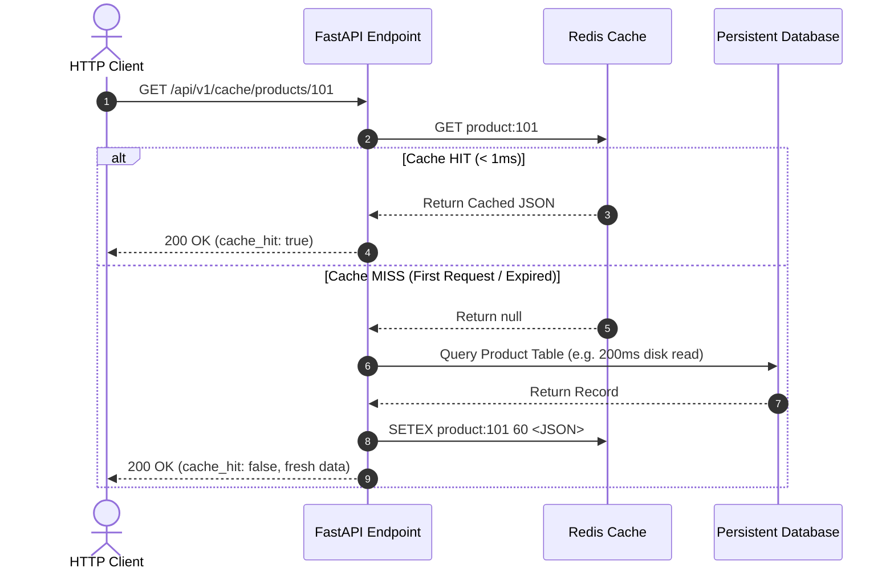
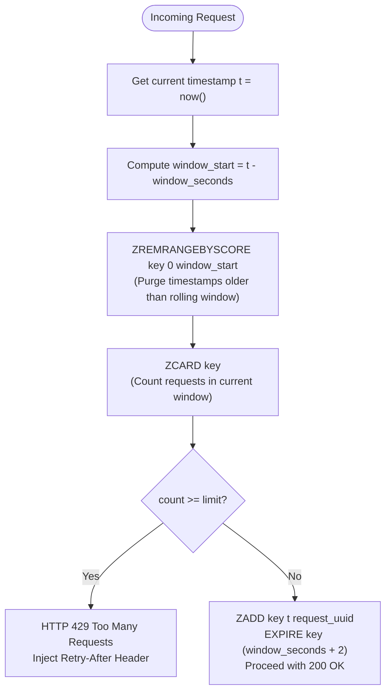

# Day 8: Async Programming, Redis Caching & Celery Hub

Welcome to **Day 8** of the intensive backend curriculum! Today covers high-throughput asynchronous execution, scalable in-memory caching, algorithmic rate limiting, and enterprise-grade distributed background processing.

---

## 📋 Curriculum & Learning Objectives

| Topic | Learning & Implementation | Expected Outcome |
| :--- | :--- | :--- |
| **Async Programming** | Event loop internals, coroutines, `async def` vs standard `def`, and `asyncio.gather()` for parallel I/O calls | Understand cooperative multitasking and execute concurrent API operations |
| **Redis Caching** | Cache-Aside (Lazy Loading) pattern, Time-To-Live (TTL), cache invalidation, and sliding-window rate limiting | Maximize read throughput, eliminate redundant calculations, and guard APIs against bursts |
| **Celery Background Tasks** | Celery worker architecture, task lifecycle states, exponential backoff retries with jitter, Celery Beat periodic crons, and Flower monitoring | Decouple slow, heavy, or volatile operations into asynchronous background worker pools |
| **BackgroundTasks vs Celery** | Architectural trade-offs, crash resilience, resource isolation, and decision framework | Select the appropriate background processing tier based on workload requirements |
| **Final Integration** | Unified multi-tiered endpoint combining async concurrency, live Redis caching, sliding-window rate limiting, and background workers | Production-ready high-concurrency API service |

---

## 🏛️ System Architecture

### 1. Redis Cache-Aside (Lazy Loading) Workflow



### 2. Redis Sliding-Window Rate Limiting (Sorted Sets / ZSET)



### 3. Celery Distributed Task Processing Topology

```mermaid
flowchart LR
    API["FastAPI Web Server<br/>(Task Producer)"] -->|1. task.delay()| Broker[("Redis Broker<br/>(Message Queue)")]
    Broker -->|2. Pull Task| Worker["Celery Worker Pool<br/>(Independent OS Process)"]
    Worker -->|3. Store Status & Result| Backend[("Redis Result Backend<br/>(Task Metadata Store)")]
    Client["Client / Frontend"] -.->|4. GET /tasks/{id}/status| Backend
```

---

## 📂 Project Structure

```text
08_async_redis_celery/
├── app/
│   ├── api/
│   │   ├── deps.py                    # Redis client & Sliding-Window Rate Limiter dependencies
│   │   └── v1/
│   │       ├── router.py              # APIRouter aggregating all endpoints
│   │       └── endpoints/
│   │           ├── async_demo.py      # Event loop, sequential vs asyncio.gather(), error handling
│   │           ├── cache_demo.py      # Cache-Aside CRUD, TTL, and cache invalidation
│   │           ├── rate_limit_demo.py # Sliding-window rate limit test endpoints (429 handling)
│   │           ├── celery_demo.py     # Celery dispatch, state polling, retry triggers, revocation
│   │           ├── comparison_demo.py # FastAPI BackgroundTasks vs Celery comparative endpoints
│   │           └── integrated.py      # Final Integration: unified dashboard endpoint
│   ├── core/
│   │   ├── config.py                  # Pydantic Settings (.env management)
│   │   └── redis_client.py            # Async Redis connection pool with FakeRedis fallback
│   ├── services/
│   │   ├── cache_service.py           # Cache-Aside service & @cached decorator
│   │   ├── external_api.py            # Async third-party service simulations
│   │   └── rate_limiter.py            # Redis Sorted Set Sliding-Window Rate Limiter
│   ├── tasks/
│   │   ├── celery_tasks.py            # Heavy batch jobs, auto-retry tasks, Celery Beat periodic crons
│   │   └── fastapi_bg.py              # In-process audit logging & telemetry tasks
│   ├── celery_app.py                  # Celery application configuration & Beat schedule
│   └── main.py                        # FastAPI application with async lifespan & CORS
├── scripts/
│   └── run_demo.py                    # End-to-end automated live demonstration script
├── tests/
│   ├── conftest.py                    # Pytest fixtures (FakeRedis, in-memory eager Celery)
│   ├── test_async_programming.py      # Tests for async def, sequential vs gather, partial failures
│   ├── test_bg_vs_celery.py           # Tests comparing FastAPI BackgroundTasks vs Celery
│   ├── test_celery_tasks.py           # Tests for Celery task queuing, polling, and retry policies
│   ├── test_integrated_api.py         # End-to-end tests for unified dashboard pipeline
│   ├── test_rate_limiter.py           # Tests for sliding window thresholds and 429 responses
│   └── test_redis_caching.py          # Tests for cache hits, misses, TTL expiry, and invalidation
├── tutorials/
│   ├── 01_async_deep_dive.py          # Standalone tutorial: Event loop, coroutines, gather benchmark
│   ├── 02_redis_caching_patterns.py   # Standalone tutorial: Cache-aside, TTL, sliding window algorithm
│   ├── 03_celery_architecture.py      # Standalone tutorial: Celery topology, states, backoff retries, Flower
│   └── 04_bg_tasks_vs_celery.py       # Standalone tutorial: Architectural trade-offs & decision matrix
├── celery_beat.py                     # Celery Beat scheduler entrypoint
├── celery_worker.py                   # Celery worker launcher with Windows solo pool support
├── pytest.ini                         # Pytest configuration
├── requirements.txt                   # Project dependencies
├── run.py                             # FastAPI server runner
├── .env                               # Active environment configuration
└── .env.example                       # Environment configuration template
```

---

## ⚖️ FastAPI BackgroundTasks vs Celery: Decision Matrix

| Criterion | FastAPI BackgroundTasks | Celery Distributed Queue |
| :--- | :--- | :--- |
| **Execution Model** | In-Process (inside ASGI worker event loop or threadpool) | Out-of-Process (dedicated background worker processes) |
| **Infrastructure** | None required (runs in web app) | Requires Broker (Redis/RabbitMQ) + Result Backend |
| **Crash Resilience** | ❌ Volatile: In-memory tasks are lost if server restarts | ✅ Persistent: Broker queues survive web server crashes |
| **Scalability** | Bound to web server CPU/RAM | Horizontally scalable to 100+ distributed worker nodes |
| **Retries & Backoff** | Manual error handling | Native exponential backoff with jitter & dead-letter queues |
| **Periodic Scheduling** | None out of the box | Native cron-style periodic jobs with Celery Beat |
| **Monitoring** | Application log files | Real-time interactive Flower web dashboard (`:5555`) |
| **Best Used For** | Audit logs, lightweight notifications (< 200ms) | PDF/video rendering, ML inference, financial settlements |

---

## 🚀 How to Run the Project

### 1️⃣ Run the 4 Standalone Interactive Tutorials

Each tutorial is completely self-contained and demonstrates key concepts with live benchmarks:

```powershell
# 1. Async Programming: Event loop, coroutines, sequential vs gather benchmark
python 08_async_redis_celery/tutorials/01_async_deep_dive.py

# 2. Redis Caching: Cache-Aside, TTL expiration, invalidation, sliding window
python 08_async_redis_celery/tutorials/02_redis_caching_patterns.py

# 3. Celery Architecture: Workers, state machine, exponential backoff retries, Flower
python 08_async_redis_celery/tutorials/03_celery_architecture.py

# 4. BackgroundTasks vs Celery: Architecture trade-offs & decision guide
python 08_async_redis_celery/tutorials/04_bg_tasks_vs_celery.py
```

### 2️⃣ Run the Automated End-to-End Live Demo

Executes a live simulated workflow against all 5 topics and outputs real-time latency comparisons:

```powershell
python 08_async_redis_celery/scripts/run_demo.py
```

### 3️⃣ Run the Automated Test Suite (16 Tests — 100% Pass)

Runs the comprehensive test suite covering async gather, cache hit/miss, cache invalidation, sliding-window rate limiting (429 handling), Celery task dispatch/status, and the unified integrated dashboard:

```powershell
python -m pytest 08_async_redis_celery/tests -v
```

### 4️⃣ Launch the FastAPI Web Application

```powershell
cd 08_async_redis_celery
python run.py
```

* **Interactive Swagger UI**: [http://127.0.0.1:8000/docs](http://127.0.0.1:8000/docs)
* **ReDoc Documentation**: [http://127.0.0.1:8000/redoc](http://127.0.0.1:8000/redoc)

### 5️⃣ Launch Celery Worker & Beat (Optional for Live Worker Queue)

> [!NOTE]
> On Windows, Celery must run with the `solo` execution pool because Windows does not support POSIX `fork()`. The included launcher handles this automatically:

```powershell
# In a separate terminal window:
python 08_async_redis_celery/celery_worker.py

# In another terminal for periodic cron scheduling:
python 08_async_redis_celery/celery_beat.py
```

### 6️⃣ Launch Flower Web Monitoring (Optional)

```powershell
celery -A 08_async_redis_celery.app.celery_app flower --port=5555
```
Access dashboard at [http://localhost:5555](http://localhost:5555).
