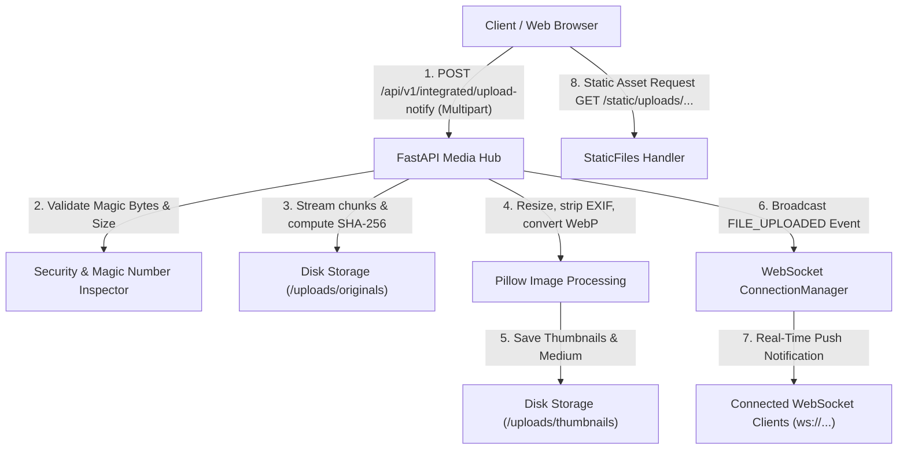

# Day 9: File Uploads, WebSockets, Testing & Code Quality

A production-grade, asynchronous media and real-time notification engine built with **FastAPI**, **Pillow**, **WebSockets**, and **Pytest**. Fully configured with rigorous code quality standards (**Black**, **isort**, **Flake8**, **mypy**, and **pre-commit**), achieving **92%+ test coverage**.

---

## 📋 Table of Contents
1. [Architectural Overview](#-architectural-overview)
2. [Key Topics & Implementations](#-key-topics--implementations)
   - [1. Secure File Uploads & Static Serving](#1-secure-file-uploads--static-serving)
   - [2. Pillow Image Processing & Variants](#2-pillow-image-processing--variants)
   - [3. WebSockets & ConnectionManager](#3-websockets--connectionmanager)
   - [4. Automated Testing with Pytest (92%+ Coverage)](#4-automated-testing-with-pytest-92-coverage)
   - [5. Code Quality & Formatting Pipeline](#5-code-quality--formatting-pipeline)
   - [6. Final Integration & Live Dashboard](#6-final-integration--live-dashboard)
3. [Project Structure](#-project-structure)
4. [Interactive Learning Tutorials](#-interactive-learning-tutorials)
5. [Quick Start & Execution Guide](#-quick-start--execution-guide)
6. [API & WebSocket Specification](#-api--websocket-specification)

---

## 🏗️ Architectural Overview



---

## 💡 Key Topics & Implementations

### 1. Secure File Uploads & Static Serving
- **Memory-Safe Streaming**: Uses FastAPI's `UploadFile` (backed by `SpooledTemporaryFile`) to stream incoming media in 64 KB chunks directly to disk, enforcing `MAX_UPLOAD_SIZE_MB` limits before memory exhaustion.
- **Magic-Byte MIME Verification**: Prevents extension spoofing attacks (e.g. executable `.exe` renamed to `.jpg`) by inspecting file binary signatures (`\xff\xd8\xff` for JPEG, `\x89PNG` for PNG, `RIFF...WEBP` for WebP, and `GIF87a`/`GIF89a`).
- **Filename Sanitization & Path Traversal Defense**: Cleans dangerous characters, strips directory traversal (`../`, `..\`), and prefixes unique UUID4 hashes. `is_safe_path()` validates that paths resolve strictly inside the root uploads folder.
- **SHA-256 Checksum Calculation**: Calculates cryptographically verifiable file hashes on the fly during streaming.
- **Static File Mounting**: Mounts `app/uploads` securely at `/static/uploads` and UI assets at `/static`.

### 2. Pillow Image Processing & Variants
- **Aspect-Ratio Preserved Resizing**: Uses high-performance `Image.Resampling.LANCZOS` anti-aliasing to resize images down without distortion or blurring.
- **Multi-Resolution Variants**:
  - `thumbnail`: Bounded to 150x150 px (ideal for feeds, avatars, and galleries).
  - `medium`: Bounded to 600x600 px (optimized for web display).
  - `original`: Preserves original resolution and metadata.
- **Format Conversion**: Generates lightweight modern WebP variants, reducing file size by up to 95%.
- **EXIF Metadata Stripping**: Strips geolocation GPS coordinates and camera serial numbers for user data privacy.

### 3. WebSockets & ConnectionManager
- **ConnectionManager Architecture**:
  - In-memory client connection tracking (`dict[str, WebSocket]`).
  - Channel / Room topic subscription system (`dict[str, set[str]]`).
  - Targeted direct messaging (`send_personal_message`).
  - Channel-specific and system-wide broadcast distribution (`broadcast`, `broadcast_to_channel`).
  - Automatic disconnection detection, cleanup, and presence announcements.
- **Protocol Features**:
  - Bi-directional client messaging with JSON payload routing.
  - Heartbeat `ping` -> `pong` keepalive mechanism.
  - HTTP-to-WebSocket bridge endpoint (`POST /api/v1/ws/broadcast`) allowing external webhooks and services to broadcast alerts.

### 4. Automated Testing with Pytest (92%+ Coverage)
- **Pytest & Pytest-Asyncio**: Comprehensive test suite with 38 unit and integration tests.
- **Test Isolation**: Autouse fixture redirects uploads into isolated temporary directories (`tmp_path`) that automatically clean up after tests.
- **Starlette TestClient WebSocket Testing**: Full-duplex WebSocket connection testing (`client.websocket_connect("/ws/{id}")`) verifying handshake, events, and disconnects.
- **Coverage**: Evaluated with `pytest-cov`, reaching **92.31% line coverage** (surpassing the 80% requirement).

### 5. Code Quality & Formatting Pipeline
- **Black**: Enforces deterministic, PEP 8 formatting with standard 88-character line length (`pyproject.toml`).
- **isort**: Automatically organizes and groups imports (Standard Library, Third-Party, Local Application).
- **Flake8**: Lints syntax, style violations, and caps cyclomatic complexity at 12 (`.flake8`).
- **Mypy**: Enforces strict static type safety (`pyproject.toml`).
- **Pre-Commit Hooks**: Configured in `.pre-commit-config.yaml` to run before Git commits.

### 6. Final Integration & Live Dashboard
- **Web UI Dashboard**: Responsive dark-mode interface served at `/` with:
  - Drag-and-drop file upload zone.
  - Live WebSocket connection status pill and client counter.
  - Real-time notification cards with thumbnail previews.
  - Media gallery browser with direct download and deletion controls.

---

## 📂 Project Structure

```
09_file_uploads_websockets_testing/
├── .env                         # Environment settings
├── .env.example                 # Template environment variables
├── .flake8                      # Flake8 linter configuration
├── .isort.cfg                   # isort configuration
├── .pre-commit-config.yaml      # Git pre-commit hooks configuration
├── pyproject.toml               # Tool configuration (Black, isort, mypy, pytest)
├── requirements.txt             # Project dependencies
├── run.py                       # FastAPI application launcher
├── README.md                    # Project documentation
├── app/
│   ├── __init__.py
│   ├── main.py                  # App entrypoint, static mounts, routers, dashboard
│   ├── core/
│   │   ├── config.py            # Pydantic Settings & path resolution
│   │   ├── exceptions.py        # Custom exceptions and HTTP handlers
│   │   └── security.py          # Filename sanitization & magic bytes detection
│   ├── schemas/
│   │   ├── file.py              # File upload responses, image variant schemas
│   │   └── websocket.py         # WebSocketEvent, client commands, broadcast schemas
│   ├── services/
│   │   ├── file_service.py      # Upload streaming, validation, disk persistence
│   │   ├── image_service.py     # Pillow resizing, thumbnails, EXIF stripping
│   │   └── websocket_manager.py # WebSocket ConnectionManager & broadcast hub
│   ├── api/
│   │   ├── deps.py              # Dependency injection providers
│   │   └── v1/
│   │       ├── router.py        # API router aggregation
│   │       └── endpoints/
│   │           ├── uploads.py   # Single & batch file upload, download, delete
│   │           ├── websockets.py# WebSocket endpoints, ping/pong, HTTP broadcast
│   │           └── integrated.py# Integrated upload + live WebSocket broadcast
│   ├── static/                  # Frontend Web Assets
│   │   ├── index.html           # Real-time web UI dashboard
│   │   ├── styles.css           # Glassmorphism styling
│   │   └── app.js               # WebSocket client & upload handlers
│   └── uploads/                 # Storage directories
│       ├── originals/
│       └── thumbnails/
├── tutorials/
│   ├── 01_file_upload_and_pillow.py         # Tutorial: File validation & Pillow transforms
│   ├── 02_websocket_connection_manager.py   # Tutorial: WebSocket protocol & ConnectionManager
│   ├── 03_testing_fastapi_websockets.py     # Tutorial: Pytest, TestClient & WebSocket tests
│   └── 04_code_quality_pipeline.py          # Tutorial: Black, isort, Flake8, mypy verification
├── tests/
│   ├── conftest.py              # Pytest fixtures (TestClient, images, temp dirs)
│   ├── test_file_uploads.py     # Single/batch upload, size, magic bytes tests
│   ├── test_image_processing.py # Pillow verification, aspect-ratio tests
│   ├── test_websockets.py       # WebSocket connections, channels, direct messaging
│   ├── test_integrated_flow.py  # End-to-end integration & static file serving tests
│   └── test_code_quality.py     # Automated programmatic linter verification
└── scripts/
    └── run_demo.py              # End-to-End live demonstration script
```

---

## 📚 Interactive Learning Tutorials

Run the tutorials to observe standalone demonstrations of each topic:

```powershell
# 1. File Uploads, Magic Bytes & Pillow Resizing
python tutorials/01_file_upload_and_pillow.py

# 2. WebSockets & ConnectionManager Simulation
python tutorials/02_websocket_connection_manager.py

# 3. Pytest & WebSocket TestClient Patterns
python tutorials/03_testing_fastapi_websockets.py

# 4. Code Quality Pipeline (Black, isort, Flake8, Mypy)
python tutorials/04_code_quality_pipeline.py
```

---

## 🚀 Quick Start & Execution Guide

### 1. Run the Live End-to-End Demo Script
Validates all 5 topics and runs the full automated test suite:
```powershell
python scripts/run_demo.py
```

### 2. Run Automated Pytest Suite with Coverage
```powershell
python -m pytest tests --cov=app --cov-report=term-missing
```

### 3. Run Code Quality Checks
```powershell
# Check formatting with Black
python -m black --check .

# Check import ordering with isort
python -m isort --check-only .

# Check linting and complexity with Flake8
python -m flake8 .

# Check static types with Mypy
python -m mypy app
```

### 4. Launch the FastAPI Real-Time Server
```powershell
python run.py
```
Open your browser to:
- **Interactive Web Dashboard**: [http://127.0.0.1:8000/](http://127.0.0.1:8000/)
- **Interactive Swagger Docs**: [http://127.0.0.1:8000/docs](http://127.0.0.1:8000/docs)
- **Service Health Check**: [http://127.0.0.1:8000/health](http://127.0.0.1:8000/health)

---

## 📡 API & WebSocket Specification

| Method | Endpoint | Description |
| :--- | :--- | :--- |
| `GET` | `/` | Serves real-time Web Dashboard UI |
| `POST` | `/api/v1/uploads` | Upload single media file and generate thumbnails |
| `POST` | `/api/v1/uploads/batch` | Upload multiple files in batch |
| `GET` | `/api/v1/uploads` | List all stored media files and thumbnails |
| `GET` | `/api/v1/uploads/{filename}` | Download original file |
| `DELETE` | `/api/v1/uploads/{filename}` | Delete file and associated variants |
| `WS` | `/ws/{client_id}` | Primary bi-directional WebSocket connection |
| `WS` | `/ws/channel/{channel}/{client_id}` | Dedicated topic channel WebSocket connection |
| `POST` | `/api/v1/ws/broadcast` | HTTP trigger to broadcast message to WebSocket listeners |
| `GET` | `/api/v1/ws/clients` | List active connected WebSocket clients |
| `POST` | `/api/v1/integrated/upload-notify` | **Integrated**: Upload image, generate variants, broadcast live WebSocket push |
| `GET` | `/api/v1/integrated/hub-status` | Hub telemetry (disk usage, active connections, presets) |
| `GET` | `/static/uploads/{path}` | Static file serving for original images and thumbnails |
