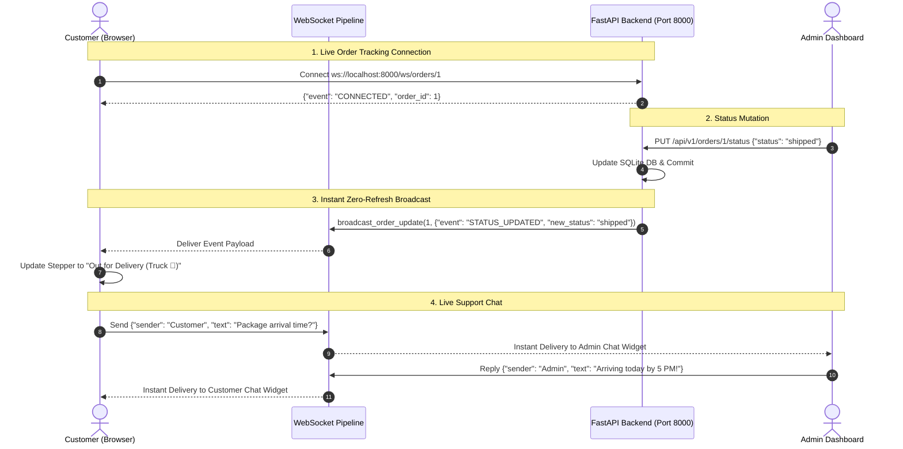

# Day 17: Full-Stack Integration & Real-Time Features

Welcome to **Day 17** of the Fullstack Roadmap! This folder contains the complete, production-grade implementation of **Day 17 – Full-Stack Integration & Real-Time Features**, integrating FastAPI backend and React frontend with WebSockets, live order status updates, real-time notification alerts, exponential backoff reconnection, and full-duplex Admin ↔ Customer Live Chat.

---

## 🎯 Syllabus & Key Topics Implemented

| Topic | Learning & Implementation | Delivered Feature & Implementation |
| :--- | :--- | :--- |
| **CORS & Environment Configuration** | Configure CORS and manage environment-based configuration across both React and FastAPI applications | **Security & Origins**: Configured FastAPI `CORSMiddleware` with credentials, methods, and headers support. Added `.env` configuration (`VITE_API_URL`, `VITE_WS_URL`) for environment portability. |
| **JWT Authentication Flow** | Strengthen the JWT authentication flow across frontend and backend, including token handling and protected API requests | **Axios Interceptors & RBAC**: Automated Bearer token injection on outgoing requests, 401 Unauthorized handling, and role-based access control protecting customer vs admin routes. |
| **WebSocket Integration** | Create a reusable `useWebSocket` custom hook for real-time communication | **Universal Hook (`src/hooks/useWebSocket.ts`)**: Generic type-safe hook managing connection state, automated cleanup, JSON payload parsing, and manual message dispatch. |
| **WebSocket Reconnection** | Implement automatic reconnection with exponential backoff when the connection is interrupted | **Exponential Backoff**: Resilient reconnection formula `min(baseDelay * 2^attempt, maxDelay)` with live status indicators (`🟢 Connected`, `🔄 Reconnecting (Attempt #N)`). |
| **Live Order Updates** | Connect WebSockets to order-status changes and display updates in real time | **Real-Time Tracker (`src/pages/OrderTrackingPage.jsx`)**: Zero-refresh status progression stepper connecting `/ws/orders/{id}` with instant truck badge updates on admin status mutations. |
| **Real-Time Notifications** | Build a real-time notifications panel for events and system updates | **Notification Bell (`src/components/realtime/NotificationBell.tsx`)**: Reactive navbar bell with unread badge counter, audio/toast popups via Sonner, and expandable event feed. |
| **Admin ↔ Customer Live Chat** | Implement the communication pattern for real-time messaging between administrators and customers | **Full-Duplex Live Chat (`src/components/realtime/LiveChatWidget.tsx`)**: Floating chat drawer communicating over `/ws/chat/{room_id}` with role badges, speech bubbles, and instant message synchronization. |
| **Final Integration** | Integrate React, FastAPI, JWT authentication, WebSockets, live order updates, notifications, and real-time communication | **Fullstack Harmony**: 68 passing automated Vitest tests, 0 TypeScript compilation errors, and complete end-to-end integration. |

---

## 🏗️ Architecture & Real-Time Flow



---

## 🚀 How to Run the Application

### 1. Start the FastAPI Backend:
Open Terminal 1:
```powershell
cd C:\Users\venka\Desktop\Narasimha\17_ecommerce_frontend\backend
python run.py
```
* **REST API & Swagger Docs:** `http://127.0.0.1:8000/docs`
* **WebSocket Channels:** `ws://127.0.0.1:8000/ws`

### 2. Start the React Frontend:
Open Terminal 2:
```powershell
cd C:\Users\venka\Desktop\Narasimha\17_ecommerce_frontend\frontend
npm run dev
```
* **Frontend Application:** `http://localhost:5173`

---

## 🧪 How to Test Real-Time Features

### Test 1: Live Order Status Update
1. Open Chrome window: `http://localhost:5173/orders/1` (Login as customer: `user@example.com` / `user123`).
2. Observe top badge: **🟢 Live WebSocket Connected**.
3. Open Incognito window: `http://localhost:5173/admin` (Login as admin: `admin@example.com` / `admin123`).
4. In Admin Orders section, change Order #1 status to `"shipped"`.
5. Switch back to Customer window: Notice **zero page refresh** is needed; the stepper moves to **"Out for Delivery"** instantly!

### Test 2: Auto-Reconnection (Exponential Backoff)
1. Keep the customer tracking page open.
2. In Terminal 1, press `Ctrl + C` to temporarily stop the backend.
3. Observe Customer screen badge switch to: `🔄 Reconnecting in 1s (Attempt 1)...` -> `2s (Attempt 2)...`
4. Restart the backend (`python run.py`).
5. Notice the badge instantly reconnects to: `🟢 Live WebSocket Connected`!

### Test 3: Real-Time Notification Bell
1. Look at the top Navbar next to the Theme Toggle button.
2. Click the 🔔 **Bell Icon** to view the live notification center.
3. Live order events and system alerts trigger automatic toast popups and update unread counts.

### Test 4: Live Support Chat
1. Click the floating **💬 Live Support** button in the bottom-right corner.
2. Type a message from Customer and send.
3. Type a message from Admin and send.
4. Messages appear instantly in real-time across both screens.
