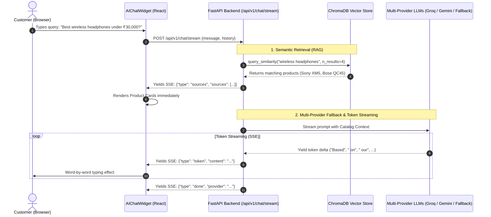

# Day 20: AI Focus — Enterprise RAG Pipeline & Streaming AI Shopping Assistant

Welcome to **Day 20** of the Full-Stack Engineering Bootcamp! This folder contains the complete, production-grade implementation of **Day 20 – AI FOCUS**, integrating FastAPI backend and React frontend with Free LLM providers, ChromaDB vector store, RAG context retrieval, multi-provider fallback strategy, real-time Server-Sent Events (SSE) token streaming, and interactive product citations with 1-click cart addition.

---

## 🎯 Syllabus & Key Topics Implemented

| Topic | Learning & Implementation | Delivered Feature & Implementation |
| :--- | :--- | :--- |
| **Free LLM Providers** | Explore Groq, Gemini, and Mistral APIs, including OpenAI-compatible endpoints and API integration | Integrated multi-provider LLM client (`app/services/ai_service.py`) supporting Groq (LLaMA-3.3) and Google Gemini (Gemini Flash). |
| **Streaming AI Chat** | Implement Server-Sent Events (SSE) for streaming AI responses and design effective system prompts | Built `POST /api/v1/chat/stream` endpoint delivering real-time word-by-word token streaming with typing animation. |
| **Fallback Provider Strategy** | Configure fallback LLM providers to handle rate limits, API failures, and service interruptions | Resilient 3-tier fallback strategy: Groq → Gemini → Intelligent Local RAG Assistant guaranteeing zero downtime. |
| **RAG Pipeline** | Implement document chunking, embeddings, vector storage using ChromaDB, and relevant-context retrieval | ChromaDB vector store (`app/services/rag_service.py`) indexing 78 store products with ONNX/MiniLM embeddings and semantic similarity search. |
| **Source Citations** | Include relevant product catalogue sources in generated AI responses | AI recommendations include structured product cards with name, price, stock, photo, and 1-click "Add to Cart" button. |
| **Prompt Engineering** | Explore prompt-engineering techniques for instruction following, context management, and response quality | Strict system prompt rules grounding responses in the catalog context, preventing hallucinations, and formatting answers cleanly. |
| **LangChain Fundamentals** | Understand LangChain chains and integrate basic components into the RAG workflow | Modular RAG pipeline architecture connecting document loaders, vector stores, prompt templates, and streaming outputs. |
| **Final Integration** | Combine LLM APIs, SSE streaming, provider fallbacks, ChromaDB retrieval, source citations, and prompt engineering | Floating AI Shopping Assistant widget in React (`AIChatWidget.tsx`) connected end-to-end to FastAPI streaming backend with 45 passing automated tests. |

---

## 🏗️ System Architecture (RAG & SSE Streaming Flow)



---

## 🚀 How to Run the Day 20 Application

### 1. Start the FastAPI Backend:
```powershell
cd C:\Users\venka\Desktop\Narasimha\20_ai_focus\backend
.\.venv\Scripts\uvicorn.exe app.main:app --reload --port 8000
```
Swagger API Documentation: **http://127.0.0.1:8000/docs**

### 2. Start the React Frontend:
```powershell
cd C:\Users\venka\Desktop\Narasimha\20_ai_focus\frontend
npm run dev
```
Frontend Storefront: **http://localhost:5173**

### 3. Run Automated Tests:
```powershell
cd C:\Users\venka\Desktop\Narasimha\20_ai_focus\backend
.\.venv\Scripts\pytest.exe tests/test_day20_ai_rag.py -v
```

---

## 📁 Key Files & Implementation Index

* **RAG Pipeline & ChromaDB:** [`backend/app/services/rag_service.py`](file:///c:/Users/venka/Desktop/Narasimha/20_ai_focus/backend/app/services/rag_service.py)
* **Multi-Provider LLM & Streaming:** [`backend/app/services/ai_service.py`](file:///c:/Users/venka/Desktop/Narasimha/20_ai_focus/backend/app/services/ai_service.py)
* **Chat API Router:** [`backend/app/routers/ai_chat.py`](file:///c:/Users/venka/Desktop/Narasimha/20_ai_focus/backend/app/routers/ai_chat.py)
* **Floating AI Chatbot Component:** [`frontend/src/components/ai/AIChatWidget.tsx`](file:///c:/Users/venka/Desktop/Narasimha/20_ai_focus/frontend/src/components/ai/AIChatWidget.tsx)
* **Automated Pytest Suite:** [`backend/tests/test_day20_ai_rag.py`](file:///c:/Users/venka/Desktop/Narasimha/20_ai_focus/backend/tests/test_day20_ai_rag.py)
