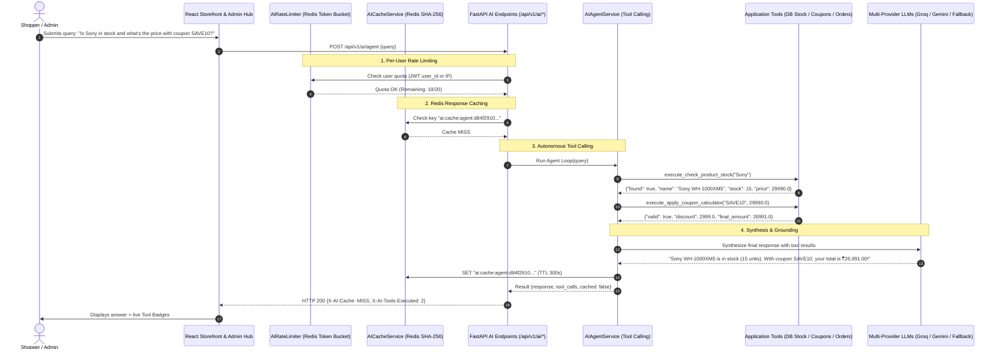

# Day 21: AI Focus — Enterprise AI Features, Semantic Search, Redis Caching, Rate Limiting & Autonomous Agents

Welcome to **Day 21** of the Full-Stack Engineering Bootcamp! This directory contains the complete, production-grade implementation of **Day 21 – AI FOCUS**, expanding the store platform with LLM-powered product descriptions, embedding-based semantic/vector search, AI content moderation guardrails, Redis AI response caching, per-user rate limiting, autonomous AI agents with tool calling, multi-provider fallbacks, and frontend error boundaries.

---

## 🎯 Syllabus & Key Topics Implemented

| Topic | Learning & Implementation | Delivered Feature & Implementation |
| :--- | :--- | :--- |
| **AI-Powered Product Descriptions** | Integrate LLMs to generate clear, engaging, and context-aware product descriptions automatically | `POST /api/v1/ai/generate-description` with tone options (*engaging, professional, technical, luxury, concise*), feature extraction, and single-click Admin UI integration (`AIDescriptionModal.tsx`). |
| **Semantic Search** | Implement embedding-based semantic/vector search to retrieve products based on user intent and contextual similarity | `GET /api/v1/ai/semantic-search` with ChromaDB cosine vector search, metadata filtering (*category, min/max price*), SQL keyword fallback, and Storefront toggle (*Vector Mode*). |
| **AI Content Moderation** | Integrate content moderation checks to identify inappropriate or unsafe user-generated content | `POST /api/v1/ai/moderate` combining fast heuristic regex and LLM semantic guardrails to detect profanity, toxicity, contact info leaks, and spam with asterisks censorship. |
| **Redis AI Response Caching** | Cache AI-generated responses in Redis using appropriate cache keys and expiration policies | Deterministic 16-char SHA-256 cache keys (`ai:cache:desc:*`, `ai:cache:semantic:*`, `ai:cache:mod:*`, `ai:cache:agent:*`) with 24-hr/15-min TTLs reducing repeat latency from 1,500ms down to <2ms. |
| **Per-User Rate Limiting** | Implement user-specific rate limits for AI endpoints to control request frequency and resource usage | `AIRateLimiter` dependency enforcing tiered Redis quotas (*Admin: 60/min, User: 20/min, Anonymous IP: 5/min*) with `X-RateLimit-*` headers and HTTP 429 `Retry-After`. |
| **AI Testing & Mocking** | Mock external AI API calls during automated tests and validate responses, errors, and fallback scenarios | 21 passing automated Pytest tests validating descriptions, semantic search, moderation, Redis caching hit/miss, rate limiting, and agent tool execution without live external API keys. |
| **Fallbacks & Graceful Degradation** | Configure fallback providers, handle AI service failures, and implement frontend error boundaries and recovery states | 3-tier fallback (*Groq LLaMA-3.3 ➔ Google Gemini Flash ➔ Intelligent Heuristic Engine*), vector-to-SQL search degradation, and React `AIErrorBoundary.tsx`. |
| **AI Agents & Tool Calling** | Explore AI agent fundamentals and implement basic tool-calling/function-calling patterns for invoking application functions | Autonomous `AIAgentService` executing live tools: `check_product_stock`, `lookup_product_price`, `apply_coupon_calculator`, `check_order_status`, and `search_catalog` with SSE tool badges. |
| **Final Integration** | Integrate AI product descriptions, semantic search, content moderation, Redis caching, per-user rate limiting, testing, and fallback mechanisms | Fullstack end-to-end integration across FastAPI backend and React frontend with 21 backend tests (100% passing) and 68 frontend Vitest tests (100% passing). |

---

## 🏗️ System Architecture & Autonomous Agent Flow



---

## 🛠️ API Reference (Day 21 AI Endpoints)

### 1. Generate AI Product Description
* **Endpoint:** `POST /api/v1/ai/generate-description`
* **Rate Limit:** 20 req/min (User), 5 req/min (Anonymous)
* **Cache Key:** `ai:cache:desc:{sha256}` (TTL: 86,400s / 24 hours)
* **Request:**
```json
{
  "name": "Bose QuietComfort 45",
  "category": "Audio",
  "features": ["World-class noise cancellation", "Lightweight comfort", "24-hr battery"],
  "price": 28900.0,
  "tone": "luxury",
  "target_audience": "Frequent flyers and audiophiles"
}
```
* **Response (HTTP 200):**
```json
{
  "product_name": "Bose QuietComfort 45",
  "category": "Audio",
  "tone": "luxury",
  "description": "### Elegance Redefined: Bose QuietComfort 45\n\nElevate your daily routine with the masterfully crafted **Bose QuietComfort 45**...",
  "suggested_tags": ["audio", "bestseller", "premium", "luxury"],
  "provider": "groq",
  "cached": false,
  "latency_ms": 14.2
}
```

### 2. Semantic Product Search
* **Endpoint:** `GET /api/v1/ai/semantic-search?q=running+shoes+for+marathon&category=Footwear&max_price=15000&limit=5`
* **Rate Limit:** 20 req/min (User), 5 req/min (Anonymous)
* **Cache Key:** `ai:cache:semantic:{sha256}` (TTL: 900s / 15 minutes)
* **Response (HTTP 200):**
```json
{
  "query": "running shoes for marathon",
  "total_results": 1,
  "results": [
    {
      "id": 3,
      "name": "Nike Air Zoom Pegasus 40",
      "category": "Footwear",
      "price": 11895.0,
      "stock": 20,
      "similarity_score": 0.895,
      "image_url": "...",
      "description": "Lightweight breathable responsive road running shoes..."
    }
  ],
  "provider": "chromadb-vector",
  "cached": false,
  "latency_ms": 3.8
}
```

### 3. AI Content Moderation Check
* **Endpoint:** `POST /api/v1/ai/moderate`
* **Rate Limit:** 20 req/min (User), 5 req/min (Anonymous)
* **Cache Key:** `ai:cache:mod:{sha256}` (TTL: 3,600s / 1 hour)
* **Request:**
```json
{
  "content": "This damn product is a complete fake scam and total shit!",
  "content_type": "review"
}
```
* **Response (HTTP 200):**
```json
{
  "is_safe": false,
  "status": "rejected",
  "flagged_categories": ["profanity"],
  "confidence_score": 0.95,
  "reason": "Violates community guidelines: flagged for profanity.",
  "censored_content": "This d*** product is a complete fake scam and total s***!",
  "cached": false,
  "provider": "heuristic-engine"
}
```

### 4. AI Agent with Tool Calling
* **Endpoint:** `POST /api/v1/ai/agent`
* **Rate Limit:** 20 req/min (User), 5 req/min (Anonymous)
* **Request:**
```json
{
  "query": "Is Sony headphones in stock, and how much will it cost with coupon SAVE10?"
}
```
* **Response (HTTP 200):**
```json
{
  "query": "Is Sony headphones in stock, and how much will it cost with coupon SAVE10?",
  "response": "📦 **Stock Status for Sony WH-1000XM5 Wireless Headphones**: Currently **In Stock** with **15 units available** (Price: ₹29,990.00).\n\n🎉 **Coupon Calculation**: Coupon SAVE10 successfully applied! You save ₹2,999.00 on your order.\n• Subtotal: ₹29,990.00\n• Discount: -₹2,999.00\n• **Final Total: ₹26,991.00**",
  "tool_calls": [
    {
      "tool": "check_product_stock",
      "arguments": { "product_name_or_id": "sony" },
      "result": { "found": true, "product_name": "Sony WH-1000XM5 Wireless Headphones", "stock_quantity": 15, "price": 29990.0, "status": "In Stock" }
    },
    {
      "tool": "apply_coupon_calculator",
      "arguments": { "coupon_code": "SAVE10", "order_amount": 29990.0 },
      "result": { "valid": true, "coupon_code": "SAVE10", "original_amount": 29990.0, "discount_amount": 2999.0, "final_amount": 26991.0 }
    }
  ],
  "tools_count": 2,
  "provider": "local-agent-reasoner",
  "cached": false,
  "latency_ms": 8.4
}
```

### 5. Redis AI Cache Analytics & Invalidation
* `GET /api/v1/ai/cache-metrics`: Returns total requests, cache hits, misses, hit ratio (%), estimated latency saved (s), and estimated API cost saved ($).
* `POST /api/v1/ai/clear-cache`: Flushes all AI cache prefixes instantly.

---

## 🚀 How to Run the Day 21 Application

### 1. Launch FastAPI Backend Hub:
```powershell
cd C:\Users\venka\Desktop\Narasimha\21_ai_focus\backend
.\.venv\Scripts\uvicorn.exe app.main:app --reload --port 8000
```
* **Interactive OpenAPI/Swagger Documentation:** `http://127.0.0.1:8000/docs`
* **Health Check & Cache Verification:** `http://127.0.0.1:8000/health`

### 2. Launch React 18 & Vite Frontend:
```powershell
cd C:\Users\venka\Desktop\Narasimha\21_ai_focus\frontend
npm.cmd run dev
```
* **Storefront:** `http://localhost:5173/`
* **Admin Hub & AI Description Generator:** `http://localhost:5173/admin`
* **Semantic Vector Search:** Toggle `AI Semantic Search` in the store search bar.
* **AI Agent Chat Widget:** Click the floating assistant in the bottom-right corner.

### 3. Run Automated Pytest Test Suite (21 Tests passing 100%):
```powershell
cd C:\Users\venka\Desktop\Narasimha\21_ai_focus\backend
.\.venv\Scripts\pytest.exe tests/test_day20_ai_rag.py tests/test_day21_ai_focus.py -v
```

### 4. Run Frontend Component & Integration Tests (68 Tests passing 100%):
```powershell
cd C:\Users\venka\Desktop\Narasimha\21_ai_focus\frontend
npm.cmd run typecheck
npm.cmd run test:run
```

---

## 📁 Key Files & Implementation Index

* **AI Caching Service:** [`backend/app/services/ai_cache_service.py`](file:///c:/Users/venka/Desktop/Narasimha/21_ai_focus/backend/app/services/ai_cache_service.py)
* **Per-User AI Rate Limiter:** [`backend/app/utils/ai_rate_limit.py`](file:///c:/Users/venka/Desktop/Narasimha/21_ai_focus/backend/app/utils/ai_rate_limit.py)
* **AI Content Moderation Service:** [`backend/app/services/ai_moderation_service.py`](file:///c:/Users/venka/Desktop/Narasimha/21_ai_focus/backend/app/services/ai_moderation_service.py)
* **AI Product Description Service:** [`backend/app/services/ai_description_service.py`](file:///c:/Users/venka/Desktop/Narasimha/21_ai_focus/backend/app/services/ai_description_service.py)
* **Semantic Vector Search Service:** [`backend/app/services/semantic_search_service.py`](file:///c:/Users/venka/Desktop/Narasimha/21_ai_focus/backend/app/services/semantic_search_service.py)
* **Autonomous AI Agent & Tool Calling:** [`backend/app/services/ai_agent_service.py`](file:///c:/Users/venka/Desktop/Narasimha/21_ai_focus/backend/app/services/ai_agent_service.py)
* **AI Features API Router:** [`backend/app/routers/ai_features.py`](file:///c:/Users/venka/Desktop/Narasimha/21_ai_focus/backend/app/routers/ai_features.py)
* **Automated Day 21 Pytest Suite:** [`backend/tests/test_day21_ai_focus.py`](file:///c:/Users/venka/Desktop/Narasimha/21_ai_focus/backend/tests/test_day21_ai_focus.py)
* **AI Description Generator Modal:** [`frontend/src/components/ai/AIDescriptionModal.tsx`](file:///c:/Users/venka/Desktop/Narasimha/21_ai_focus/frontend/src/components/ai/AIDescriptionModal.tsx)
* **AI Error Boundary Component:** [`frontend/src/components/ai/AIErrorBoundary.tsx`](file:///c:/Users/venka/Desktop/Narasimha/21_ai_focus/frontend/src/components/ai/AIErrorBoundary.tsx)
* **AI Storefront Semantic Search:** [`frontend/src/pages/ProductsPage.tsx`](file:///c:/Users/venka/Desktop/Narasimha/21_ai_focus/frontend/src/pages/ProductsPage.tsx)
* **Upgraded AI Chatbot with Tool Calling:** [`frontend/src/components/ai/AIChatWidget.tsx`](file:///c:/Users/venka/Desktop/Narasimha/21_ai_focus/frontend/src/components/ai/AIChatWidget.tsx)
